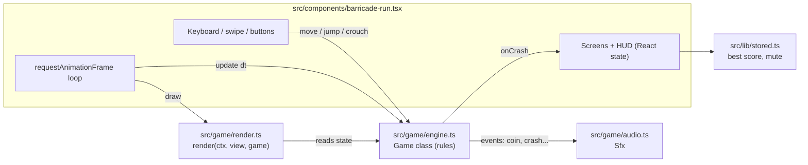
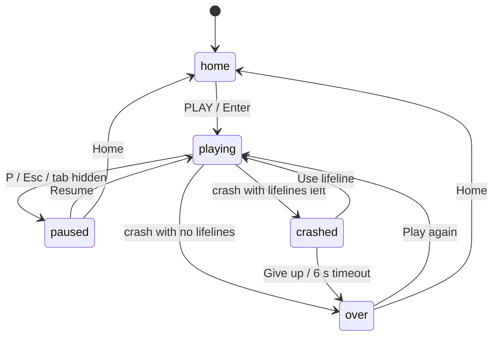

# How Barricade Run Was Built

A step-by-step walkthrough of the code, in the order the pieces depend on each other. Each step names
the file, explains what it does and why, and shows the key code. Read it top to bottom to understand
the game, or jump to a step when you need to change something.

## Contents

- [How Barricade Run Was Built](#how-barricade-run-was-built)
  - [Contents](#contents)
  - [Architecture at a glance](#architecture-at-a-glance)
  - [Step 1: Project setup](#step-1-project-setup)
  - [Step 2: World units and tuning constants](#step-2-world-units-and-tuning-constants)
  - [Step 3: Game engine: rules and simulation](#step-3-game-engine-rules-and-simulation)
    - [3.1 State](#31-state)
    - [3.2 Input methods](#32-input-methods)
    - [3.3 Fixed substeps](#33-fixed-substeps)
    - [3.4 One simulation step](#34-one-simulation-step)
    - [3.5 Spawning that is always fair](#35-spawning-that-is-always-fair)
    - [3.6 Collisions: crash versus stumble](#36-collisions-crash-versus-stumble)
    - [3.7 The police chase](#37-the-police-chase)
    - [3.8 Lifelines](#38-lifelines)
    - [3.9 Ghost mode (home screen demo)](#39-ghost-mode-home-screen-demo)
  - [Step 4: Renderer: pseudo-3D on a 2D canvas](#step-4-renderer-pseudo-3d-on-a-2d-canvas)
    - [4.1 Projection](#41-projection)
    - [4.2 Drawing primitives](#42-drawing-primitives)
    - [4.3 Frame order](#43-frame-order)
    - [4.4 People](#44-people)
    - [4.5 Performance tricks](#45-performance-tricks)
  - [Step 5: Sound: Web Audio synth](#step-5-sound-web-audio-synth)
  - [Step 6: Saved settings: localStorage store](#step-6-saved-settings-localstorage-store)
  - [Step 7: React component: screens, loop and input](#step-7-react-component-screens-loop-and-input)
    - [7.1 Screens](#71-screens)
    - [7.2 Refs versus state](#72-refs-versus-state)
    - [7.3 Starting a run](#73-starting-a-run)
    - [7.4 The render loop](#74-the-render-loop)
    - [7.5 Canvas resolution and adaptive quality](#75-canvas-resolution-and-adaptive-quality)
    - [7.6 Input](#76-input)
  - [Step 8: Styling: HUD, overlays and touch pad](#step-8-styling-hud-overlays-and-touch-pad)
  - [Step 9: PWA: install and offline play](#step-9-pwa-install-and-offline-play)
    - [9.1 Manifest](#91-manifest)
    - [9.2 Service worker](#92-service-worker)
    - [9.3 Registration and the cache handoff](#93-registration-and-the-cache-handoff)
    - [9.4 Install prompt](#94-install-prompt)
  - [Step 10: App icons generator](#step-10-app-icons-generator)
  - [Step 11: Share script for another laptop](#step-11-share-script-for-another-laptop)
  - [Run it](#run-it)
  - [Tuning cheat sheet](#tuning-cheat-sheet)
  - [How to add a new obstacle](#how-to-add-a-new-obstacle)

## Architecture at a glance



The key design rule: **the engine knows nothing about drawing, and the renderer never changes game
state.** The engine is plain TypeScript with no DOM access, the renderer only reads it, and React glues
them together and owns the screens.

## Step 1: Project setup

**Files:** `package.json`, `next.config.ts`, `tsconfig.json`, `src/app/layout.tsx`, `src/app/page.tsx`

The project is a Next.js 16 App Router app with React 19 and TypeScript. There is no game engine and
no asset files. Everything is drawn with canvas shapes and every sound is synthesised.

`next.config.ts` turns on static export, so `npm run build` writes a plain HTML/JS site to `out/` that
any static host can serve:

```ts
const nextConfig: NextConfig = {
  output: "export",
  images: { unoptimized: true },
};
```

`src/app/page.tsx` renders a single client component:

```tsx
export default function Home() {
  return <BarricadeRun />;
}
```

`src/app/layout.tsx` sets the page metadata and a viewport tuned for a full-screen game: no pinch zoom
(`userScalable: false`), `viewportFit: "cover"` so the canvas reaches under phone notches, and the
`ServiceWorker` component from Step 9.

## Step 2: World units and tuning constants

**File:** `src/game/constants.ts`

Before any logic, the world needs a coordinate system. One unit is one metre:

- `x` is left/right. Lane centres are at `-2.4`, `0` and `2.4` (`LANE_W = 2.4`).
- `y` is height above the road.
- `z` is distance down the road, away from the camera. **The player always stays at `z = 0`.** The world
  moves towards the player instead of the player moving forward.

```ts
export const LANE_W = 2.4;
export const LANES = [-1, 0, 1] as const;
export const ROAD_HALF = 4.0;     // road edge
export const VIEW_DIST = 140;     // how far ahead things are spawned and drawn
export const CAM_H = 3.6;         // camera height
export const CAM_BACK = 6;        // camera distance behind the player
```

The file also holds every gameplay number (gravity, jump speed, speed ramp, chase timer, lifelines),
the obstacle sizes, and the protest text: placard slogans, street banners and billboard headlines in
English, Hinglish and Hindi. Keeping these in one file means balancing the game never requires reading
engine code. See the [tuning cheat sheet](#tuning-cheat-sheet).

The `FONT` stack includes Devanagari fonts (`Nirmala UI`, `Noto Sans Devanagari`) so Hindi text renders
on Windows, Android and macOS.

## Step 3: Game engine: rules and simulation

**File:** `src/game/engine.ts`

The `Game` class holds the full state of one run and every rule. It has no DOM or canvas code, so it
can be reasoned about (and tested) on its own.

### 3.1 State

```ts
export class Game {
  status: RunStatus = "running";   // "running" | "crashed"
  time = 0;
  distance = 0;
  speed = START_SPEED;
  coins = 0;
  lifelines = FREE_LIFELINES;
  chaseT = START_CHASE_TIME;       // seconds the police stay on your heels
  chaserZ = -2.4;                  // where chasing officers are drawn

  player: Player = { lane: 0, prevLane: 0, x: 0, y: 0, vy: 0, crouchT: 0, invulnT: 0, runPhase: 0 };
  obstacles: Obstacle[] = [];
  pickups: Pickup[] = [];          // coins and hearts
  protesters: Protester[] = [];    // sidewalk crowd (decoration)
  banners: StreetBanner[] = [];    // cloth banners (decoration)
  papers: Paper[] = [];            // flying exam sheets (decoration)
}
```

Score is derived, not stored: `Math.floor(distance) + coins * 10`.

The constructor takes a `GameEvents` object (`onCoin`, `onJump`, `onCrash`...). The engine calls these
hooks and the component plugs sound effects and screen changes into them. This keeps audio and React
out of the engine.

### 3.2 Input methods

The component calls three methods. Each one checks `status` first, so input during a crash is ignored.

- `move(dir)` changes `player.lane` immediately and remembers `prevLane` (needed to bounce back after
  clipping an obstacle). The visible `x` position eases towards the lane later, in `updatePlayer`.
- `jump()` works only when grounded. It sets upward velocity `JUMP_V` and cancels a crouch.
- `crouch()` starts a 0.7 s slide. Pressed mid-air, it also forces a fast fall
  (`vy = min(vy, FAST_FALL_V)`), the same feel as Subway Surfers.

### 3.3 Fixed substeps

Frame time varies, and at top speed (34 m/s) a slow frame can move the world more than the depth of a
thin barricade. The engine splits every frame into substeps of at most 1/120 s so collisions cannot be
skipped:

```ts
update(dt: number) {
  const steps = Math.ceil(dt / (1 / 120));
  for (let i = 0; i < steps && this.status === "running"; i++) this.step(dt / steps);
}
```

### 3.4 One simulation step

`step(dt)` runs in this order:

1. **Speed ramp.** `speed = min(MAX_SPEED, START_SPEED + time * SPEED_GAIN)`, so speed climbs from 15 to
   34 m/s over about two minutes.
2. **Player physics** (`updatePlayer`). Lane easing, gravity, landing, timers counting down.
3. **Chase timer.** `chaseT` counts down. `chaserZ` eases towards `-2.4` (right behind you) while the
   chase is on and back to `-14` (off screen) when it ends.
4. **Scroll the world.** Every obstacle, pickup and decoration has `z` reduced by `speed * dt`. Oncoming
   buses also subtract their own `vz`.
5. **Recycle scenery.** A protester, banner or paper that passes behind the camera is re-rolled with new
   random looks and moved to the far end. The crowd is a fixed pool that loops, so nothing is allocated
   during play.
6. **Drop old objects.** Obstacles and pickups behind the camera are filtered out.
7. **Spawn ahead.** While the next row position is inside `VIEW_DIST`, spawn another obstacle row plus
   a coin line in the gap after it.
8. **Collide** (or run the autopilot in ghost mode).

### 3.5 Spawning that is always fair

`spawnRow(z)` places 1 to 3 obstacles across shuffled lanes. Rows with more obstacles get more likely as
`difficulty` (0 to 1 over 120 s) rises. The fairness rule:

```ts
// With all three lanes blocked, the last one must be jumpable or slidable.
const kind: ObstacleKind =
  count === 3 && i === 2
    ? pick(["barricade", "banner"] as const)
    : weighted({ barricade: 3, banner: 2, police: 3, bus: 2 + 2 * d });
```

Officers and buses can only be dodged by changing lane, so a full row always keeps one barricade (jump)
or police line (crouch).

Other spawning details:

- **Gap between rows** scales with speed and shrinks with difficulty, with a minimum of 11 m:
  `max(11, speed * rand(0.8, 1.25) * (1.25 - 0.45 * difficulty))`.
- **Oncoming buses.** Some buses get `vz > 0` and drive at you. This only happens when the lane in front
  of them is empty (`laneClearAhead`), and coins in that lane are removed so they don't float through
  the bus.
- **Coins.** A straight line of up to 10 coins in a random lane fills each gap. Barricades sometimes get
  a 5-coin arc over the top (`spawnCoinArc`) that rewards jumping.
- **Hearts.** With a 4% chance, the middle coin of a line becomes a lifeline pickup, but only when you
  have fewer than `MAX_LIFELINES`.

### 3.6 Collisions: crash versus stumble

`collide()` first checks pickups (a simple box around the player), then obstacles. Skipped entirely
while `invulnT > 0`.

For each obstacle overlapping the player in `z` and `x`, it decides whether the player is blocked:

| Obstacle             | Blocked when                                                         |
| -------------------- | -------------------------------------------------------------------- |
| Barricade            | Player's feet are below the barricade top (did not jump high enough) |
| Police line (banner) | Player's head is above the 1.15 m clearance (not crouching)          |
| Officer, bus         | Always                                                               |

Then the important distinction:

```ts
if (o.lane === p.lane && dx < 0.6) {
  this.crash(o.kind);          // hit it head-on
  return;
}
// Clipped the side while changing lanes: stumble and bounce back.
o.grazed = true;
if (o.lane === p.lane) p.lane = p.prevLane;
this.stumble();
```

A head-on hit ends the run (or offers a lifeline). Clipping an obstacle mid lane change is a stumble:
you bounce back to your previous lane and the police start chasing.

### 3.7 The police chase

```ts
private stumble() {
  if (this.chaseT > 0) {
    this.crash("caught");      // second stumble while chased
    return;
  }
  this.chaseT = CHASE_TIME;    // 6 seconds
  this.events.onStumble?.();
}
```

Each run starts with a short 2.5 s chase (`START_CHASE_TIME`) for atmosphere. A stumble starts a 6 s
chase, and a second stumble inside that window gets you caught.

### 3.8 Lifelines

When the player crashes, `status` becomes `"crashed"` and the simulation stops. If the player spends a
lifeline, `revive()`:

- decrements `lifelines` and resumes the run,
- cancels the chase,
- removes every obstacle within 30 m so you don't crash again instantly,
- puts the player back on the ground in the centre of their lane,
- grants `INVULN_TIME` (2.5 s) of protection.

### 3.9 Ghost mode (home screen demo)

`new Game({}, true)` creates an attract-mode run for the home screen. It keeps a constant speed, never
collides and runs a tiny `autopilot()`: if something is in its lane within 14 m, switch to the nearest
free lane, otherwise jump a barricade or crouch under a police line.

## Step 4: Renderer: pseudo-3D on a 2D canvas

**File:** `src/game/render.ts`

The renderer draws the engine state with the plain Canvas 2D API. It fakes 3D with perspective
projection and the painter's algorithm (draw far things first).

### 4.1 Projection

Every world point goes through one function:

```ts
function project(v: View, x: number, y: number, z: number): Projected {
  const s = v.focal / (z + CAM_BACK);     // pixels per metre at this depth
  return { x: v.cx + (x - v.camX) * s, y: v.horizon + (v.camH - y) * s, s };
}
```

Objects further away (larger `z`) get a smaller scale `s`, so they shrink and move towards the horizon.
`s` is also returned so callers can size things in metres.

`makeView(w, h)` computes the view for the current canvas size. In portrait (phones held upright) the
camera is raised (`camH = CAM_H * 1.9`) and the ground line is moved up, so more road fits on a narrow
screen.

`camX` follows the player sideways at 55% of their offset, with easing, so lane changes feel like the
camera swings with you:

```ts
v.camX += (game.player.x * 0.55 - v.camX) * 0.15;
```

### 4.2 Drawing primitives

- `poly(ctx, v, color, pts)` projects a list of 3D points and fills the polygon.
- `strip(...)` is a flat ground quad between two `x` and two `z` values. Road, sidewalks and lane marks
  are all strips.
- `box(...)` draws a 3D box: the side face that the camera can see, the top face if it's below the
  camera, and the front face. It returns the front face's screen rectangle so callers can paint
  details onto it (stripes on a barricade, the windscreen on a bus). Boxes partly behind the camera
  are clipped at `NEAR_Z`.

### 4.3 Frame order

`render()` draws each frame in layers:

1. **Backdrop.** Sky gradient and a two-layer city skyline with lit windows. This never changes, so
   `buildBackdrop` paints it once into an offscreen canvas when the view is created. Each frame just
   stamps it with a small sideways parallax from `camX`.
2. **Ground.** Asphalt, sidewalks and kerbs, then alternating 4 m segments that scroll with `distance`
   (lighter paving, yellow kerb paint, dashed lane lines). Scrolling stripes are what make the road
   feel like it's moving.
3. **Buildings.** Repeating 14 m blocks on both sides. Height, wall colour and lit windows come from
   `hash(k, side)`, a deterministic pseudo-random function, so a block looks the same every frame
   without storing anything. Some block ends carry a news billboard.
4. **Sprites, sorted by depth.** Everything else (protesters, banners, papers, street lamps,
   obstacles, pickups, the player, the chasing officers) is pushed into one list with its `z`, sorted
   far to near, and drawn in that order:

   ```ts
   sprites.sort((a, b) => b.z - a.z);
   for (const sp of sprites) sp.draw();
   ```

5. **Siren glow.** While `chaseT > 0`, a red/blue gradient flashes on the screen edges.

### 4.4 People

`figure(ctx, x, groundY, scale, style, pose)` draws a person from simple shapes: legs, torso, arms with
an elbow bend, neck, head and hair. `FigureStyle` controls clothing (kurta, dupatta, long hair, Gandhi
topi, police cap, riot helmet, backpack) and `Pose` controls the arms (placard held up, fist pumping,
flag, carrying a banner). The run cycle is a sine wave on `phase` that lifts alternate feet.

The same function draws the player (seen from behind), protesters, banner carriers and police. The
officer adds a lathi (baton) and, for the road-blocking riot police, a transparent shield.

### 4.5 Performance tricks

- **Cached text labels.** Drawing text is the most expensive canvas call. Every placard, banner,
  billboard and "POLICE" plate is painted once into a small offscreen canvas (keyed by text, colours and
  size in the `labels` map), then stamped each frame with `drawImage`.
- **Level of detail.** A protester under 8 px tall is drawn as four rectangles instead of a full
  figure. Eyes and backpack straps only appear when a figure is larger than 14 px. Building windows
  stop being drawn when they would be under 2.5 px.
- **Culling.** Anything behind `NEAR_Z` or beyond its draw distance is skipped before it reaches the
  sprite list.

## Step 5: Sound: Web Audio synth

**File:** `src/game/audio.ts`

The `Sfx` class generates every sound at runtime, so there are no audio files to download or cache
offline.

- `tone(type, from, to, duration)` plays an oscillator that sweeps from one pitch to another while its
  volume fades out. Coin, jump, crouch and lane sounds are single tones with different waveforms and
  pitches.
- `noise(duration)` fills a buffer with random samples that fade out. Stumble and crash layer noise
  with a falling tone.
- `setSiren(on)` schedules a two-tone police siren (720/960 Hz alternating every 0.4 s). It's safe to
  call every frame because it returns early when the state hasn't changed.

Browsers block audio until a user gesture, so `unlock()` creates the `AudioContext` and is called from
the PLAY button handler. Mute ramps the master gain to 0 instead of stopping sounds abruptly.

## Step 6: Saved settings: localStorage store

**File:** `src/lib/stored.ts`

`storedNumber(key, fallback)` wraps one localStorage value with `get`, `set` and a React hook built on
`useSyncExternalStore`:

```ts
export const bestScore = storedNumber("barricade-run:best");
export const mutedPref = storedNumber("barricade-run:muted");
```

Why this shape:

- Components re-render when the value changes, including from another tab (`storage` event).
- The server render sees `fallback`, so there's no hydration mismatch with the static export.
- Every storage access is in `try/catch`. In private mode or with storage full, the game keeps working
  without saving.

## Step 7: React component: screens, loop and input

**File:** `src/components/barricade-run.tsx`

This component owns the canvas, the game loop, input, and every screen.

### 7.1 Screens

```ts
type Screen = "home" | "playing" | "paused" | "crashed" | "over";
```



### 7.2 Refs versus state

The game loop runs 60 times a second, outside React's render cycle. Values the loop reads live in
refs (`gameRef`, `screenRef`, `viewRef`, `sfxRef`) so the loop always sees the current value without
re-subscribing. React state (`screen`, `hud`, `crash`, `result`) only drives the overlays.

`go(next)` updates both at once:

```ts
const go = useCallback((next: Screen) => {
  screenRef.current = next;
  setScreen(next);
}, []);
```

### 7.3 Starting a run

`start()` unlocks audio, creates a new `Game` and wires engine events to sounds. `onCrash` decides the
next screen: `"crashed"` (lifeline offer) if any lifelines remain, otherwise `finish()`, which saves a new
best score and shows `"over"`.

A `useEffect` on the `"crashed"` screen sets a 6 s timer (`LIFELINE_DECISION_TIME`) that calls `finish()`
if the player doesn't act. A CSS bar drains over the same duration.

### 7.4 The render loop

One `requestAnimationFrame` loop runs for the whole page lifetime:

```ts
const frame = (now: number) => {
  raf = requestAnimationFrame(frame);
  const dt = Math.min(0.05, elapsed / 1000);        // clamp long pauses
  const game = s === "home" ? demoRef.current : gameRef.current;
  const live = s === "home" || s === "playing";
  if (live) game.update(dt);
  render(ctx, viewRef.current, game, clock);
  // throttled HUD + siren updates while playing
};
```

- On the home screen it animates the ghost demo run behind the menu.
- When paused or crashed it keeps drawing the frozen scene but doesn't update it.
- `dt` is clamped to 50 ms so returning from a background tab doesn't teleport the world.
- HUD state is pushed to React at most every 100 ms. Calling `setHud` every frame would re-render the
  overlays 60 times a second for no visible benefit.
- A `visibilitychange` listener auto-pauses when the tab is hidden.

### 7.5 Canvas resolution and adaptive quality

The canvas is created with `{ alpha: false }`, so the browser doesn't blend it with the page.

Resolution starts at the device pixel ratio, capped at 2 on desktop and 1.5 on touch devices (phones
are limited by fill rate). The loop then samples 90 frames at a time. If more than half took over
22 ms (below about 45 fps), it drops the render scale by 0.25, down to 0.75. A `ResizeObserver` rebuilds
the view and backdrop whenever the canvas size changes.

### 7.6 Input

Three input paths call the same engine methods:

| Input     | Handler                         | Notes                                                                                                                 |
| --------- | ------------------------------- | --------------------------------------------------------------------------------------------------------------------- |
| Keyboard  | `keydown` on `window`           | Arrows/WASD/Space while playing. Enter/Space start, resume or use a lifeline on other screens. Key repeat is ignored. |
| Swipe     | Pointer events on `<main>`      | Fires once per gesture after 30 px of movement. Dominant axis decides lane change versus jump/crouch.                 |
| Touch pad | Four buttons with `data-action` | Uses `onPointerDown` (not `onClick`) for zero delay, and stops propagation so a button press isn't read as a swipe.   |

## Step 8: Styling: HUD, overlays and touch pad

**File:** `src/app/globals.css`

Plain CSS, no framework. Main pieces:

- `.game` is `position: fixed; inset: 0` with `touch-action: none` and no text selection, so swipes
  don't scroll, zoom or select anything. `.game-canvas` fills it.
- `.hud` shows score, coins, hearts and the pause button. `.chase-banner` flashes "POLICE ON YOUR TAIL!".
- `.touch-controls` is a diamond of four buttons on the right side. A `(pointer: coarse)` media query
  shows it only on touch devices.
- `.overlay` and `.panel` style every menu screen. `.ticker` is the scrolling "BREAKING" news strip on the
  home screen.
- `.countdown` uses a `drain` keyframe animation whose duration is set inline from
  `LIFELINE_DECISION_TIME`.
- `@media (max-height: 560px)` compacts the panels for phones in landscape.
- `@media (prefers-reduced-motion: reduce)` stops the pulsing, siren and ticker animations.

## Step 9: PWA: install and offline play

**Files:** `src/app/manifest.ts`, `public/sw.js`, `src/components/pwa.tsx`

### 9.1 Manifest

`manifest.ts` is a Next.js metadata route that outputs `/manifest.webmanifest`: name, colours,
`display: "fullscreen"` and three icons, including a maskable one for Android adaptive icons.
`export const dynamic = "force-static"` lets it work with static export.

### 9.2 Service worker

`public/sw.js` uses two caching strategies:

| Request                                               | Strategy                           | Why                                                                      |
| ----------------------------------------------------- | ---------------------------------- | ------------------------------------------------------------------------ |
| Page navigation                                       | Network first, cache fallback      | Updates appear as soon as you're online. Offline, the cached page loads. |
| Everything else (hashed `/_next/static` files, icons) | Cache first, refresh in background | Hashed files never change, so serving from cache is safe and instant.    |

On `install` it caches the core files. On `activate` it deletes caches from older versions (bump
`CACHE = "barricade-run-v1"` to force a clean cache).

### 9.3 Registration and the cache handoff

`ServiceWorker` in `pwa.tsx` registers `/sw.js` in production builds only (a service worker in
`next dev` would serve stale code).

There's one subtle problem: on the very first visit, the JS and CSS load **before** the worker exists,
so the worker never sees those requests and can't cache them. The fix is to send the worker the list
of files the page already loaded:

```ts
const urls = performance.getEntriesByType("resource").map((e) => e.name)
  .filter((u) => u.startsWith(location.origin));
reg.active?.postMessage({ type: "cache", urls: [location.href, ...urls] });
```

The worker's `message` handler adds them to the cache. After one visit, the game works fully offline.

### 9.4 Install prompt

- `useInstallPrompt()` captures Chrome/Edge/Android's `beforeinstallprompt` event and exposes an
  `install()` function. The home screen shows an "Install app" button only when it's available.
- `useIosInstallHint()` detects iPhone/iPad Safari (including iPads that report as Mac) when not already
  installed, and the home screen shows "tap Share, then Add to Home Screen" instead.

## Step 10: App icons generator

**File:** `scripts/generate-icons.mjs` (`npm run icons`)

The icons are drawn by code, not an image editor. The script computes a colour for every pixel (sky
gradient, road, a striped barricade, siren lights) and writes PNG files by hand with Node's `zlib`
(it builds the PNG header, CRC32 checksums and compressed pixel data itself). There are no image
dependencies.

The maskable icon uses a `pad` value that shrinks the artwork towards the centre, so Android's circular
or rounded masks don't crop it.

It writes `public/icon-192.png`, `public/icon-512.png`, `public/icon-maskable-512.png`,
`src/app/icon.png` and `src/app/apple-icon.png`.

## Step 11: Share script for another laptop

**File:** `scripts/make-share.mjs` (`npm run share`)

This packs the whole project into a single copy-paste Node script, for moving it to a machine without
git access. Output goes to `barricade-run-share/` (ignored by git):

| File                      | Use                                                                  |
| ------------------------- | -------------------------------------------------------------------- |
| `setup-barricade-run.mjs` | New laptop: creates `./barricade-run` with every file, then installs |
| `sync-barricade-run.mjs`  | Existing copy: makes it identical to this version                    |
| `HOW-TO-SETUP.md`         | Instructions for the person receiving it                             |

How it works:

1. Walks the project, skipping `node_modules`, build output, `.env` files and the generated icons (the
   target machine regenerates those with Step 10, which keeps the script small).
2. Stores each file with a short SHA-256 hash, gzips the whole list as JSON and base64-encodes it.
3. Writes the payload as `//~ ` comment lines at the end of the script, followed by `//~END`. If a paste
   gets cut off, the script is still valid JavaScript, so it can detect the damage (missing `//~END` or a
   hash mismatch) and say "copy it again" instead of crashing with a syntax error.
4. At runtime, unchanged files are skipped by hash. In sync mode, files that are no longer part of the
   project are moved to `.sync-backup/`, never deleted, so local work can be recovered.

When you delete or rename a file in the project, add its old path to `OBSOLETE` in `make-share.mjs` so
updates clean it up.

## Run it

```bash
npm install
npm run dev        # http://localhost:3000 (no service worker in dev)
npm run build      # static site in ./out
npm start          # serve ./out to test install and offline mode
```

## Tuning cheat sheet

All values are in `src/game/constants.ts` unless noted.

| Want to change                | Constant                            | Current                     |
| ----------------------------- | ----------------------------------- | --------------------------- |
| Starting speed                | `START_SPEED`                       | 15 m/s                      |
| Top speed                     | `MAX_SPEED`                         | 34 m/s                      |
| How fast speed grows          | `SPEED_GAIN`                        | 0.16 m/s per second         |
| Jump height                   | `JUMP_V`, `GRAVITY`                 | 10.5, 30 (about 1.8 m peak) |
| Slide duration                | `CROUCH_TIME`                       | 0.7 s                       |
| Lane change snappiness        | `LANE_SWITCH_RATE`                  | 16                          |
| Chase window after a stumble  | `CHASE_TIME`                        | 6 s                         |
| Free lifelines per run        | `FREE_LIFELINES`                    | 1                           |
| Maximum lifelines             | `MAX_LIFELINES`                     | 3                           |
| Time to decide on a lifeline  | `LIFELINE_DECISION_TIME`            | 6 s                         |
| Protection after revive       | `INVULN_TIME`                       | 2.5 s                       |
| Time to reach full difficulty | `difficulty` getter in `engine.ts`  | 120 s                       |
| Heart spawn chance            | `spawnCoins` in `engine.ts`         | 4% per coin line            |
| Slogans and headlines         | `PLACARDS`, `BANNERS`, `BILLBOARDS` |                             |

## How to add a new obstacle

Example: a water cannon truck.

1. **Size.** Add an entry to `OBSTACLE` in `constants.ts`, for example
   `cannon: { w: 2.3, h: 3.0, len: 8 }`. `ObstacleKind` updates automatically.
2. **Spawn weight.** Add it to the `weighted({...})` call in `spawnRow` in `engine.ts`.
3. **Collision rule.** In `collide()`, the `blocked` check treats unknown kinds as always blocking. Add a
   branch only if it can be jumped or slid under.
4. **Drawing.** Write `drawCannon(ctx, v, o, clock)` in `render.ts` (use `box()` for the body and paint
   details on the rectangle it returns), then add it to the `draw` selection in `render()`.
5. **Crash message.** Add a line to `CRASH_TEXT` in `barricade-run.tsx`. TypeScript will flag it as
   missing until you do.
6. **Autopilot (optional).** If it's jumpable or slidable, teach `autopilot()` in `engine.ts`, so the home
   screen demo doesn't run straight through it.
